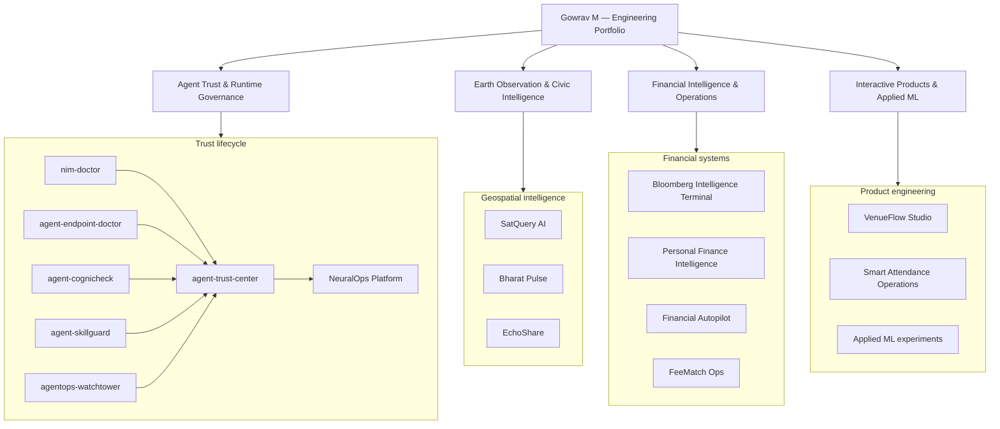

  
  

---

## 👋 About Me

I'm **Gowrav M**, an engineering student and builder interested in **AI systems, full-stack products, geospatial intelligence, and developer tooling**.

I like taking ambitious ideas beyond a demo: understanding the problem, designing the architecture, building the product, and tightening the reliability and security around it.

- **Current interests:** agentic AI, AI safety and observability, geospatial systems, applied machine learning
- **Building with:** TypeScript, React, Next.js, Python, Node.js, PostgreSQL, Supabase
- **Exploring:** MCP ecosystems, model evaluation, retrieval and evidence pipelines, production engineering
- **Based in:** India 🇮🇳

> I value working software, inspectable evidence, and clear engineering trade-offs over inflated claims.

---

## 🚀 Selected work

These projects are linked directly to their repositories so the implementation and documentation can be inspected.

<table>
  <tr>
    <td width="50%" valign="top">
      <h3>🛰️ SatQuery AI</h3>
      
<strong>Earth-observation visual question answering and analysis.</strong>

      
Explores satellite imagery workflows across optical and SAR data, deterministic raster measurements, scientific guardrails, and traceable evidence.

      <a href="https://github.com/Gowrav-M/satquery-ai-sih-2026-evidence">Evidence repository →</a>
    </td>
    <td width="50%" valign="top">
      <h3>🛡️ AgentOps Watchtower</h3>
      
<strong>Local-first observability and security for AI agents.</strong>

      
Inspects MCP tool surfaces and runtime traces, builds risk evidence, and supports capability-policy workflows.

      <a href="https://github.com/Gowrav-M/agentops-watchtower">Repository →</a>
    </td>
  </tr>
  <tr>
    <td width="50%" valign="top">
      <h3>🌏 Bharat Pulse</h3>
      
<strong>Civic intelligence and geospatial monitoring.</strong>

      
A public showcase for a platform focused on mapping civic signals and presenting data for operational analysis.

      <a href="https://github.com/Gowrav-M/bharat-pulse-showcase">Showcase repository →</a>
       
    </td>
    <td width="50%" valign="top">
      <h3>🌱 EchoShare</h3>
      
<strong>Community-led environmental reporting.</strong>

      
A full-stack sustainability application for geo-tagged pollution reports, community coordination, maps, and AI-assisted enrichment.

      <a href="https://github.com/Gowrav-M/EchoShare">Repository →</a>
    </td>
  </tr>
  <tr>
    <td width="50%" valign="top">
      <h3>💸 Personal Finance Intelligence</h3>
      
<strong>Transaction intelligence and financial analytics.</strong>

      
Explores transaction ingestion, classification, forecasting, anomaly detection, and conversational analysis.

      <a href="https://github.com/Gowrav-M/Personal-Finance-Management-System">Repository →</a>
    </td>
    <td width="50%" valign="top">
      <h3>🤖 Financial Autopilot</h3>
      
<strong>Privacy-first multi-agent finance prototype.</strong>

      
A local Python and SQLite project for spending analysis, scenario simulation, and habit-oriented insights.

      <a href="https://github.com/Gowrav-M/financial-autopilot-agent">Repository →</a>
    </td>
  </tr>
</table>

---

## 🔐 Agent trust engineering

I’m also exploring a connected set of focused tools around the security lifecycle of AI agents:

| Project | Focus |
| --- | --- |
| [Agent Cognicheck](https://github.com/Gowrav-M/agent-cognicheck) | Pre-deployment checks for agent tools and skills |
| [Agent SkillGuard](https://github.com/Gowrav-M/agent-skillguard) | Skill approval, integrity, and policy workflows |
| [Agent Endpoint Doctor](https://github.com/Gowrav-M/agent-endpoint-doctor) | Endpoint diagnostics |
| [Agent Trust Center](https://github.com/Gowrav-M/agent-trust-center) | Consolidated trust and evidence workflows |
| [AgentOps Watchtower](https://github.com/Gowrav-M/agentops-watchtower) | Runtime observability and capability controls |

See the [NeuralOps Platform](https://github.com/Gowrav-M/neuralops-platform) for related platform work.

---

## Technology stack

The stack below reflects technologies present across the public projects or actively explored in their implementations.

**Application engineering**

**Data and infrastructure**

**AI, research and geospatial**

  
  

Technology logos indicate tools used or explored across the portfolio; they do not imply that every project uses the entire stack.

---

## Engineering systems map

A portfolio-level view of the main engineering domains and how the projects fit together.

---

## Project portfolio

The repository set is organized by the engineering problem each system addresses. Expand a track to inspect its projects and implementation focus.

<strong>01 — Agent security, trust and governance</strong> · 6 repositories

| Project | Engineering focus |
| --- | --- |
| [Agent Trust Center](https://github.com/Gowrav-M/agent-trust-center) | Normalizes evidence from specialist tools into Markdown, HTML and JSON trust reports with CI gating |
| [AgentOps Watchtower](https://github.com/Gowrav-M/agentops-watchtower) | MCP runtime observability, capability firewall, attack-path evidence and OpenTelemetry traces |
| [Agent SkillGuard](https://github.com/Gowrav-M/agent-skillguard) | Skill supply-chain admission, provenance, SkillBOM, approval records and policy-as-code |
| [Agent Cognicheck](https://github.com/Gowrav-M/agent-cognicheck) | Local-first cognitive security scans and attack harnesses for MCP tools and agent skills |
| [Agent Endpoint Doctor](https://github.com/Gowrav-M/agent-endpoint-doctor) | Compatibility probes for chat, streaming, tool calls, JSON mode, responses and embeddings |
| [NIM Doctor](https://github.com/Gowrav-M/nim-doctor) | NVIDIA NIM model readiness checks and reproducible endpoint evidence |

**Platform extension:** [NeuralOps](https://github.com/Gowrav-M/neuralops-platform) explores scoped agent identities, approval workflows, short-lived authorization leases, revocation and operator controls.

<strong>02 — Earth observation, geospatial and civic intelligence</strong> · 4 repositories

| Project | Engineering focus |
| --- | --- |
| [SatQuery AI — Evidence Dossier](https://github.com/Gowrav-M/satquery-ai-sih-2026-evidence) | Multi-sensor Sentinel-1/2 analysis, deterministic raster measurements, scientific guardrails and a cryptographic evidence graph |
| [SatQuery AI — Application](https://github.com/Gowrav-M/satquery-ai) | Natural-language investigation over remote-sensing imagery with multimodal analysis workflows |
| [Bharat Pulse — Public Showcase](https://github.com/Gowrav-M/bharat-pulse-showcase) | Civic signal monitoring, satellite map visualization, multi-source validation and geospatial analytics |
| [EchoShare](https://github.com/Gowrav-M/EchoShare) | Geo-tagged environmental reporting, community coordination, maps and AI-assisted enrichment |

<strong>03 — Financial intelligence and operations</strong> · 4 repositories

| Project | Engineering focus |
| --- | --- |
| [Bloomberg Intelligence Terminal](https://github.com/Gowrav-M/Bloomberg-v4) | Live market data, world directory, AI-assisted analysis and persistent financial workspaces |
| [Personal Finance Intelligence System](https://github.com/Gowrav-M/Personal-Finance-Management-System) | Gmail transaction ingestion, classification, forecasting, anomaly detection and conversational analytics |
| [Financial Autopilot Agent](https://github.com/Gowrav-M/financial-autopilot-agent) | Local-first multi-agent spending analysis, scenario simulation and habit insights |
| [FeeMatch Ops](https://github.com/Gowrav-M/feematch-ops-local) | Explainable fee reconciliation, duplicate detection, audit trails and multi-tenant financial workflows |

<strong>04 — Product engineering, 3D systems and applied ML</strong> · 4 repositories

| Project | Engineering focus |
| --- | --- |
| [VenueFlow Studio](https://github.com/Gowrav-M/venueflow-studio) | AI-assisted 3D commercial-space planning, layout constraints, safety checks and professional exports |
| [Smart Attendance & Academic Operations](https://github.com/Gowrav-M/smart-attendance-ops) | Hardware-independent attendance architecture, offline event ingestion and deterministic finalization |
| [Machine Learning — Regression](https://github.com/Gowrav-M/Machine-learning) | Exploratory analysis and simple/multiple linear regression |
| [ML2 — Classification](https://github.com/Gowrav-M/ML2) | Iris classification, decision-tree training, evaluation and visualization |

<strong>Additional experiments</strong>

- [Autonomous Personal Finance AI](https://github.com/Gowrav-M/Autonomous-Personal-Finance-Al) — linked AI Studio prototype.
- [All public repositories](https://github.com/Gowrav-M?tab=repositories) — browse the complete public project history.

---

## Live GitHub analytics

These visual reports are generated from GitHub data and stored in this repository. They are self-hosted SVGs rather than third-party stats endpoints, and the workflow refreshes them automatically.

<a href="https://github.com/Gowrav-M?tab=overview">
  <picture>
    <source media="(prefers-color-scheme: dark)" srcset="./assets/profile/overview.dark.svg" />
    
  </picture>
</a>

<a href="https://github.com/Gowrav-M?tab=overview">
  <picture>
    <source media="(prefers-color-scheme: dark)" srcset="./assets/profile/contributions.dark.svg" />
    
  </picture>
</a>

<strong>Explore deeper activity visualizations</strong>

<a href="https://github.com/Gowrav-M?tab=repositories">
  <picture>
    <source media="(prefers-color-scheme: dark)" srcset="./assets/profile/languages.dark.svg" />
    
  </picture>
</a>

<a href="https://github.com/Gowrav-M?tab=repositories">
  <picture>
    <source media="(prefers-color-scheme: dark)" srcset="./assets/profile/repositories.dark.svg" />
    
  </picture>
</a>

<a href="https://github.com/Gowrav-M?tab=overview">
  <picture>
    <source media="(prefers-color-scheme: dark)" srcset="./assets/profile/composition.dark.svg" />
    
  </picture>
</a>

<a href="https://github.com/Gowrav-M?tab=overview">
  <picture>
    <source media="(prefers-color-scheme: dark)" srcset="./assets/profile/rhythm.dark.svg" />
    
  </picture>
</a>

<picture>
  <source media="(prefers-color-scheme: dark)" srcset="https://raw.githubusercontent.com/Gowrav-M/Gowrav-M/output/github-snake-dark.svg" />
  <source media="(prefers-color-scheme: light)" srcset="https://raw.githubusercontent.com/Gowrav-M/Gowrav-M/output/github-snake.svg" />
  
</picture>

---

## Connect

  
Engineered with curiosity. Documented with evidence. Improved continuously.

